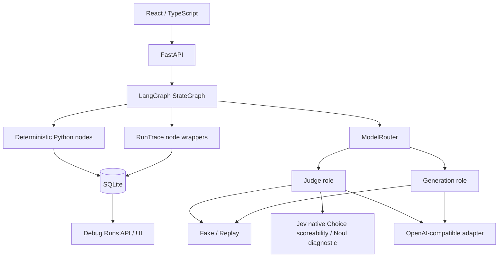
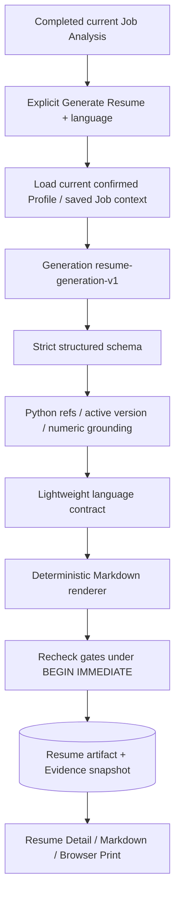

# Architecture

## Fixed workflow boundaries



Phase 1 的 dummy graph 只有固定边：`START → prepare_input → mutate_state → END`。它只证明工作流和追踪闭环，不承担 Career Profile 功能。ModelRouter 独立构建，其网络分支不会被 dummy graph 使用。Phase 2 新增独立 `profile_workflow`，固定 load → extract → validate facts → normalize → validate profile → persist。确认是独立 Python/API 事务，不在 AI Graph 内。

Phase 3.5B-R 的独立九节点 Job Analysis graph：确认门禁 → Generation extraction → validation → Jev scoreability → Python guard → 全量证据 Generation matching → validation → Python Coverage → 原子保存；Phase 4 已新增独立七节点 Resume Generation graph。用户确认和显式生成简历的授权边界由 API/Python 检查。不存在 Agent loop、ToolRegistry、模型动态选边、MCP、RAG、embedding、auth 或多用户设计。

## Generation task inference policy (Phase 4.3)

```text
Task policy (PromptSpec.reasoning_effort)
    ↓
Role-level fallback (GENERATION_REASONING_EFFORT)
    ↓
Provider default (wire field absent)
```

这是 deterministic inference configuration。唯一显式 task policy 为 profile-facts-v1=low，其余 Generation task 默认 None。RoleModel 每次调用解析 effective reasoning/source，live 时复制 role ModelConfig 注入 Provider，不修改共享 role 配置。task override 优先；role-level low/high/max 能力保留，默认 unset。Workflow 只调用 task，Provider 不知道业务 task policy。没有模型名/URL 检测，没有 Agent 决策、模型动态选 reasoning、self-reflection 或 dynamic graph routing；业务图不变。

成功/失败/fake/replay trace 记录 reasoning_effort 和 reasoning_source=task/role/provider_default；表示最终请求配置，不是服务端执行确认。不存 hidden reasoning，不扩 token schema。Canonical replay hash 仍只由 task/version/business payload 决定，fixtures 无变化。Judge/Jev 不变。

Settings API 保留 role 配置，新增只读 task_policies，显式仅序列化 task name 与 reasoning policy；不返回完整 PromptSpec、正文、URL 或 secret。前端只读。角色 timeout 默认 30/30 秒、本地 60/30 秒；本地全局 reasoning override 已注释。实验及边界见 [PHASE_4_3.md](PHASE_4_3.md)。

## JD requirement category contract alignment

`jd-requirements-v2` 的 importance 原已明确 required/preferred，实际校验正常；category 的九值 Literal 原只存在于 Pydantic schema，未在 prompt 列举。用户 trace 在 HTTP 200、JSON shape 正确的 20 条 requirements 中出现 16 个 category literal_error，importance errors=0。json_object 保证 JSON 对象输出，不保证本地 Pydantic Literal compliance；此次修复针对 category schema/prompt contract mismatch。

Prompt 的 category 列表直接由现有 `ExtractedRequirement.model_fields["category"].annotation` 的 Literal 参数生成：education、experience、skill、certification、language、capability、logistics、personal_trait、other。要求 exactly one of，禁止 invent/translate/rename/synonyms/其他值。原 Pydantic schema 完全不变，仍是最终 authoritative validator；没有新增 enum、映射、归一化、repair、fallback 或业务规则改动。

架构原则：当 Provider 使用 json_object 而不保证 strict json_schema 时，模型可枚举字段必须同时在 Prompt contract 和本地 Pydantic schema 中保持一致。此修复通过现有 schema 生成 prompt 列表及 deterministic 集合一致性测试防止漂移，无需重构模型层。MockTransport 验证合法 JSON 经 Pydantic 到完整 Job Analysis；未知 programming 继续严格拒绝，不保存结果。reasoning、retry、timeout、scoreability/Jev 与 structured output 配置均不由此修复改变。

验证结果及既有未提交 reasoning 修改导致的工作区回归差异见 [HANDOFF.md](HANDOFF.md)。没有 live 请求；真实 JD 验收由用户重启 backend 后执行。

## State and persistence

`CareerState` 当前只有 message / counter / result。节点返回部分更新，LangGraph 合并状态；不维护聊天历史，也不提前加入空业务字段。

SQLite schema v4 保留 `workflow_runs` 与 `node_traces`，增加单例 `career_profile` 与 `career_evidence`，以及 `jobs` / `job_requirements` / `job_matches`。Job 保存时事务内复查确认及版本，全部要求、匹配、Coverage 原子发布；历史引用保留 Evidence，读取时动态计算 outdated。Profile 原文及原文历史、Generation facts、AI 原始整理、用户编辑、上次确认快照分别保留；确认与 Evidence 更新在一个 `BEGIN IMMEDIATE` 事务中完成。所有写操作携带 expected_version，工作流最后写回再次检查，避免旧结果覆盖新内容。普通读事务保证 Profile/Evidence 同一快照。每次写入均在独立事务中提交，开启 WAL、foreign keys、10 秒 busy timeout。每个 workflow 请求创建独立 RunTrace，UUID run_id，节点 sequence 从 1 开始。没有全局共享执行状态。

`node_traces` 使用 `(run_id, sequence)` 主键及 run foreign key；具体 trace 为 JSON，允许后续添加 metadata 而不先建立大量空列。时间保存 UTC ISO 8601，耗时使用 monotonic performance counter。UI 列表以 Asia/Shanghai 展示时间。

本阶段不做 graph checkpoint、崩溃恢复或大型迁移框架。v1/v2/v3 → v4 幂等新增表，保留 trace；未知更高 schema 版本拒绝启动。进程在执行中被杀死会保留 running run；不会伪造 completed 状态。后续需要可恢复业务边界时，独立加入 checkpoint/recovery 设计。

## Observability and privacy

Run：workflow name/version、开始/完成、status、duration、error_code。

Node：name、sequence、开始、duration、status、input/output summary、变化字段的 before/after 摘要、validation result、error_code。

AI metadata：model_role、provider、model_name、prompt_version、temperature、input/output/total tokens、latency_ms、retry_count。一个 AI node 预期执行一次 role model task；重试成本累加到同一次调用的 usage。Provider 未返回 usage 时记录 0，不估算真实消耗。fake/replay 的 0 表示本次没有实际模型消耗。

ContextVar 将单次模型调用 metadata 交给当前 node wrapper，finally 中恢复上下文，避免并发请求串线。节点失败也保存 trace，保留已知错误码；未知错误映射 workflow-specific fallback。原始异常文本不写入数据库或 HTTP 响应。

默认字符串只保存长度，列表只保存数量，字典保存结构；counter 等非字符串标量可保存变化值。State diff 只包括变化字段，不 dump 全部 state。开发环境显式开启全文开关后，才记录节点输入/输出及 AI prompt、输入和结构化输出。开关关闭后，即使旧记录有 payload，API 也不返回它。

已配置的 secrets、常见 secret key、Bearer、sk- token 在写入 trace 前脱敏。不记录 hidden chain-of-thought。API Settings 明确 allowlist 字段，拒绝直接序列化 Settings 或模型配置。数据库是本地应用数据，不是 secret vault；不要将敏感字符串用作模型名、字段名或业务 ID。

Debug API 仅 development 可用，production/test 均返回 404。这不是 authentication；本地服务默认绑定 loopback，不部署公网。

## Configurable Provider output contract（Phase 3.5B-R2）

Provider wire format 与业务 schema 分层。ModelConfig.structured_output_mode 支持 json_schema/json_object；Settings 的 GENERATION_STRUCTURED_OUTPUT 默认 json_schema，只有显式选择才调整 Generation。json_schema 保留 name/strict=true/原 Pydantic schema；json_object 只发送 response_format.type=json_object，不发送 schema 参数或改变任务 prompt。GLM 本地显式选 json_object，不按 URL/模型名自动推断 capability；Judge/Jev 原协议不变。

两种模式共享 R1 的解析、严格 schema.model_validate_json 和后续 business grounding；不 strip fence、repair、coerce 或 fallback。原 invoke 仍携带业务 schema，PromptSpec 不变。Settings API models 与 AI metadata 新增 structured_output_mode；Jev 的 Settings 字段为 null，trace 不伪装成 JSON 输出。前端 Settings 展示该配置值。Profile eval 成功分支显式记录 schema_mapping_success/business_validation_success。

R2 唯一一次原 education synthetic live 已通过 HTTP/JSON/Pydantic/business，但 exact eval 标题差异仍计 mismatch；R3 已完成 JD/Jev Step 2–4 live baseline，详见下节。实现、237/16 项测试和完整结果见 [PHASE_3_5B_R2.md](PHASE_3_5B_R2.md)。以下 R1 保留为诊断设计和历史失败依据。

## Live acceptance baseline（Phase 3.5B-R3）

**Phase 3.5B-R3 Step 2–4 Live Acceptance 完成，已停止，未开始 Phase 4。**

R2 已验证 GLM json_object Profile contract。本轮 GLM `openai-compatible / glm-5.3-flash / json_object` 的 JD jd-01 通过 HTTP 200、JSON parsing、严格 Pydantic 及原 JD validation：title=`Synthetic role 1`，1 个 `Python / required / skill` requirement。exact metrics：requirement_missing=0、unsupported_addition=0、importance_correct/total=1/1、category_correct/total=1/1，两个 accuracy 均 1.0。title 与 reference 相同，但现有 metrics 不评估 title。

Jev `jev-1.13.0` native Choice 单例 score-0（身体健康）raw/guarded/reference 均 NON_SCORABLE。8-case reviewed benchmark 合并为一次请求，raw=8/8、guarded=8/8（均 100%）；SCORED=2/2、NEEDS_CONFIRMATION=2/2、NON_SCORABLE=4/4（raw/guarded 相同）。guard corrected=0、harmed=0，全部 guard_adjusted=false。

JD / Jev single / Jev batch latency=7952.355 / 550.898 / 527.180 ms；input/output/total tokens=151/547/698、495/51/546、2122/389/2511。实际请求数 **3**，retry 全为 0；合计 input/output/total tokens=2768/987/3755，调用 latency 合计 9030.433 ms。所有 request_success/schema_mapping_success=true。

仅既有 synthetic eval，无业务 graph/DB 访问、真实用户数据或 normalization/matching live，AI_DEBUG_PAYLOADS=0。JD 业务 validator 就是 JobRequirements.model_validate，无另加 grounding 校验。没有改代码/schema/prompts/guard，未重跑完整 regression；结果本地核验通过。当前 8-case 分数不代表总体准确率，逐 case 及结果见 [PHASE_3_5B_R3.md](PHASE_3_5B_R3.md)。

## Structured output failure stages（Phase 3.5B-R1）

OpenAICompatibleProvider 明确分开 HTTP → provider JSON → envelope/usage → assistant string content → structured JSON → Pydantic；Profile workflow 随后独立执行 business grounding。HTTP/network 继续 MODEL_REQUEST_FAILED，输出错误继续公开 MODEL_OUTPUT_INVALID；原 Profile business error code 不变。内部 metadata 区分 RESPONSE_ENVELOPE_INVALID、STRUCTURED_JSON_INVALID、PYDANTIC_VALIDATION_FAILED、BUSINESS_VALIDATION_FAILED。

只有 development + AI_DEBUG_PAYLOADS=1 提供 loc/type/固定安全消息及受限的 parsed JSON shape，默认只有 stage。Pydantic input/context、原始异常消息、完整失败正文、reasoning/header 均不进入新增诊断。shape 只保存字段/类型，不保存字段值；trace/eval 沿用最终 redaction。Profile validators 仅给原条件命名并记录 rule，不改接受/拒绝语义。模型 stage 进入 AI_OBSERVER/node.ai；后续 business stage 进入 node.validation_result，独立 eval failure report 区分成功 schema 与失败 grounding。

Provider 仍发送原 name/schema/strict=true，仍用 schema.model_validate_json；不自动 strip fence、repair、fallback、coerce 或宽松 schema。官方 GLM 文档未声明当前 json_schema/strict contract，记录 capability mismatch；R1 唯一一次 synthetic 请求实际返回 fence，定位 structured JSON 层失败后停止。完整依据、测试、原失败不可追溯限制和请求计数见 [PHASE_3_5B_R1.md](PHASE_3_5B_R1.md)。

## Provider and prompt boundary

Phase 3.5B 核对发现 Jev 的 Noul/Choice/Score 不能生成开放文本及动态数组，历史失败记录保留于 [PHASE_3_5B.md](PHASE_3_5B.md)。Phase 3.5B-R 据此调整模型职责：

```text
Generation / GLM
├─ profile-facts-v1
├─ profile-normalize-v1
├─ jd-requirements-v2 (text / importance / category)
├─ matching-v1
└─ resume-generation-v1 (Phase 4)
Judge / Jev
└─ scoreability-v1 (finite native Choice)
Python
└─ requirement IDs / validation / minimal safety guard / evidence / coverage
```

只拆分 scoreability，不迁移其他判断。职责重构及离线回归完成。原 Step 1 失败记录见 [PHASE_3_5B_R.md](PHASE_3_5B_R.md)；R2 已验证 Profile contract，R3 已完成 JD/Jev Step 2–4，详见 [PHASE_3_5B_R3.md](PHASE_3_5B_R3.md)。

Settings 在应用构造时加载一次，角色专用配置优先，共享配置回退。Node 仅接受注入的依赖，不直接读取环境变量。

Phase 4.1 增加 **Role-specific provider timeout**：`GENERATION_TIMEOUT_SECONDS` / `JUDGE_TIMEOUT_SECONDS` 默认均 30，启动时验证有限数值 `0 < timeout <= 300`，非法值报配置错误，不 clamp。沿 `Settings → ModelConfig.timeout_seconds → ModelRouter → Provider(timeout_seconds) → httpx.Client` 注入；Provider 不读取环境变量。Jev 使用 Judge 配置，默认 30 秒，协议与 retry 不变。本地 Generation 显式覆盖为 60 秒，保留 GLM/json_object/prompt/output limit。timeout 属于 infrastructure config，不改变 Resume workflow。

Settings API allowlist 与页面显示各角色 `timeout_seconds`；AI metadata 在成功和失败时均记录该配置。沿用 HTTPX timeout 语义（connect/read/write/pool 各阶段超时），不是整次调用的硬性 wall-clock deadline；`latency_ms` 仍记录原 monotonic 全调用耗时。网络错误继续映射 `MODEL_REQUEST_FAILED`，安全 failure class 为 `provider_metadata.error_kind`，不返回原异常消息。live eval 仍 max_attempts=1、retry=0。Phase 4 原 30 秒失败历史保留，60 秒验证结果见 [PHASE_4_1.md](PHASE_4_1.md)。

每个可执行 task 有 PromptSpec：版本、角色、prompt、输出上限、温度。已实现 diagnostic-v1、profile-facts-v1、profile-normalize-v1、jd-requirements-v2、scoreability-v1、matching-v1（历史 jd-extract-v1 保留），Pydantic strict 输出 schema 禁止额外字段。Generation 从 raw 提取事实并保留连续原文 quote；Generation 仅接收 facts，输出恰好一条 entry 对应一个 source_index，校验类型和数字保留。用户编辑有独立来源标记，不覆盖 raw/AI 版本。不扩展为工具注册驱动的流程。

live 按 role provider 配置选择专用 adapter：Jev POST `/systemone`（state/questions），OpenAI-compatible POST `/chat/completions`（`json_schema` structured output）。默认 fake/replay 不构造网络 adapter/client。Jev 支持 `judge-diagnostic-v1` 和 `scoreability-v1`，其余 task 在发送输入前拒绝。scoreability 一份 state 下按 requirement index 批量建 Choice questions，原生 response 在 provider 层转换为 ScoreabilityResult。Python 验证完整唯一映射，workflow 再执行原有 safety guard。Profile facts 仅换 role，旧 JD v1 不修改，业务 extraction 使用 v2。新增 `generation-diagnostic-v1` 使用既有 Generation contract。客户端角色专用 timeout 默认均为 30 秒（Phase 4.1 可配置），不跟随 redirect；最多两次尝试，无嵌套 SDK 重试，无 repair 对话。HTTP/网络错误是 MODEL_REQUEST_FAILED，结构/校验错误是 MODEL_OUTPUT_INVALID。未来业务节点的特定错误分类已列入 ErrorCode。

独立 smoke 要求 AI_MODE=live + --live + --role，固定 synthetic 输入，严格一次尝试（不使用常规重试预算）。复用 RunTrace 记录 diagnostic run/node，不调用业务 graph/store，不读写业务表。Jev 已知 response_model/probability/request id 放现有 provider_metadata JSON，继续脱敏，无 schema migration。细节、真实验证状态见 [PHASE_3_5A.md](PHASE_3_5A.md)。

replay 使用 task + prompt_version + 输入 canonical hash 选择明确 fixture。不存在记录、版本不匹配、非法 schema 均明确失败，不调用 live。两个新 tasks 同样支持 fake/replay，Debug UI 保留历史 tasks 并增加新 tasks。独立 synthetic eval 默认强制 replay，live 双 gate 且无重试；scoreability 8-case 批量一个请求，分别记录 raw/guarded accuracy。Eval 不运行业务 graph，也不打开 SQLite。独立 replay API 固定 replay 模式，即使主服务为 live，仍然不会进行网络请求。replay 不修改业务数据、runs 或 trace。

## Extension boundaries

- Phase 2 已实现 Profile/Evidence、事实提取与整理、用户编辑和确认。Evidence ID 是 Python 对 canonical entry + raw provenance 的 SHA-256，重复操作稳定，实际变化保守重建，旧行 inactive 保留。
- 下游必须调用 confirmed_profile() 门禁，保存 profile_version。已确认资料后续修改使未来 Job Analysis / Resume outdated；Job 已保存 profile_version；schema v4 已创建 Resume 表及历史 Evidence 快照。
- Phase 3 已增加 requirements/matches、全量 active evidence 输入、Python 引用校验及 Coverage，详见 [PHASE_3.md](PHASE_3.md)。
- Phase 4 已增加 resume gate、结构化逐事实引用、grounding、语言、Markdown/print；详见下节。
- Resume revision 未来独立 graph，加载当前 resume + evidence + JD，不默认重复 JD extraction/matching。
- Evaluation fixtures 与运行追踪分别保存；Phase 2 有 10 个 synthetic reviewed cases 和独立 extraction/normalization replay；默认离线 exact comparison 只衡量 regression，不代表 live 模型质量。
- Phase 2 细节和限制见 [PHASE_2.md](PHASE_2.md)。


## Evidence-grounded Resume (Phase 4)



固定图，不增加 Agent loop。只读取现有 Job requirements/matches/Coverage 和当前版本 active Evidence。模型按岗位优先级安排真实事实，不把 JD/GAP 或 match explanation 当成候选人事实。Python 检查结构、引用和数字，不声称证明自然语言语义。

ResumeDraft = language + cited headline + cited summary claims + ordered sections(kind/items)。所有文本字段均引用至少一个 canonical Career Evidence ID，禁止重复 refs/sections、空事实、额外字段。工作职位、公司、日期如使用，包含在带引用的完整 item 内。数字复用 Profile helper，仅对该项引用 normalized_content 检查。

v4 resumes 存 job_id/profile_version/language/status/structured_resume_json/markdown/evidence_json/created_at。最终事务内复查确认、版本、Job 状态和 Evidence，任何失败无半完成 artifact。Evidence 使用引用内容快照；没有 Job 删除级联，linked Job 缺失时历史 Resume 仍展示且 outdated。读取动态计算版本/确认/Job outdated，不自动重生成。

POST/GET `/api/jobs/{job_id}/resumes`、GET/DELETE `/api/resumes/{resume_id}`；每次明确生成新 artifact。Job Detail 选择语言，Resume Detail 使用同一结构显示正文，Python Markdown 可查看，print CSS 隐藏导航/Evidence。Debug replay 强制离线且不写业务/trace。七节点沿用 shape-only trace，grounding metrics 为确定性 counts，全文仍需 development + opt-in。

离线 267 backend / 21 frontend、6-case Resume eval、全回归与 fake HTTP 通过。唯一一次 GLM json_object synthetic live（retry=0）在 30084.153 ms ReadTimeout，没有输出，live grounding/Markdown 尚未验收，已停止。详细 schema、metrics、结果和限制见 [PHASE_4.md](PHASE_4.md)。
