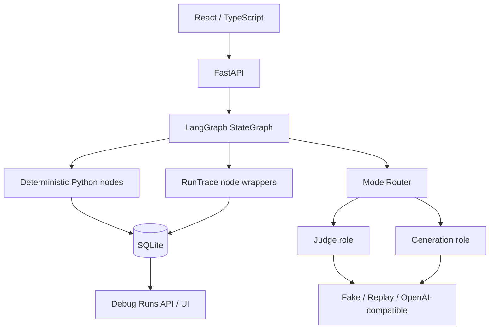

# Architecture

## Fixed workflow boundaries

Phase 1 的 dummy graph 只有固定边：`START → prepare_input → mutate_state → END`。它只证明工作流和追踪闭环，不承担 Career Profile 功能。ModelRouter 独立构建，其网络分支不会被 dummy graph 使用。Phase 2 新增独立 `profile_workflow`，固定 load → extract → validate facts → normalize → validate profile → persist。确认是独立 Python/API 事务，不在 AI Graph 内。

后续分别增加 Profile、Job Analysis、Resume Generation graph；用户确认和显式生成简历的授权边界由 API/Python 检查。不存在 Agent loop、ToolRegistry、模型动态选边、MCP、RAG、embedding、auth 或多用户设计。

## State and persistence

`CareerState` 当前只有 message / counter / result。节点返回部分更新，LangGraph 合并状态；不维护聊天历史，也不提前加入空业务字段。

SQLite schema v2 保留 `workflow_runs` 与 `node_traces`，增加单例 `career_profile` 与 `career_evidence`。Profile 原文及原文历史、Judge facts、AI 原始整理、用户编辑、上次确认快照分别保留；确认与 Evidence 更新在一个 `BEGIN IMMEDIATE` 事务中完成。所有写操作携带 expected_version，工作流最后写回再次检查，避免旧结果覆盖新内容。普通读事务保证 Profile/Evidence 同一快照。每次写入均在独立事务中提交，开启 WAL、foreign keys、10 秒 busy timeout。每个 workflow 请求创建独立 RunTrace，UUID run_id，节点 sequence 从 1 开始。没有全局共享执行状态。

`node_traces` 使用 `(run_id, sequence)` 主键及 run foreign key；具体 trace 为 JSON，允许后续添加 metadata 而不先建立大量空列。时间保存 UTC ISO 8601，耗时使用 monotonic performance counter。UI 列表以 Asia/Shanghai 展示时间。

本阶段不做 graph checkpoint、崩溃恢复或大型迁移框架。v1 → v2 幂等新增表，保留 trace；未知更高 schema 版本拒绝启动。进程在执行中被杀死会保留 running run；不会伪造 completed 状态。后续需要可恢复业务边界时，独立加入 checkpoint/recovery 设计。

## Observability and privacy

Run：workflow name/version、开始/完成、status、duration、error_code。

Node：name、sequence、开始、duration、status、input/output summary、变化字段的 before/after 摘要、validation result、error_code。

AI metadata：model_role、provider、model_name、prompt_version、temperature、input/output/total tokens、latency_ms、retry_count。一个 AI node 预期执行一次 role model task；重试成本累加到同一次调用的 usage。Provider 未返回 usage 时记录 0，不估算真实消耗。fake/replay 的 0 表示本次没有实际模型消耗。

ContextVar 将单次模型调用 metadata 交给当前 node wrapper，finally 中恢复上下文，避免并发请求串线。节点失败也保存 trace，保留已知错误码；未知错误映射 workflow-specific fallback。原始异常文本不写入数据库或 HTTP 响应。

默认字符串只保存长度，列表只保存数量，字典保存结构；counter 等非字符串标量可保存变化值。State diff 只包括变化字段，不 dump 全部 state。开发环境显式开启全文开关后，才记录节点输入/输出及 AI prompt、输入和结构化输出。开关关闭后，即使旧记录有 payload，API 也不返回它。

已配置的 secrets、常见 secret key、Bearer、sk- token 在写入 trace 前脱敏。不记录 hidden chain-of-thought。API Settings 明确 allowlist 字段，拒绝直接序列化 Settings 或模型配置。数据库是本地应用数据，不是 secret vault；不要将敏感字符串用作模型名、字段名或业务 ID。

Debug API 仅 development 可用，production/test 均返回 404。这不是 authentication；本地服务默认绑定 loopback，不部署公网。

## Provider and prompt boundary

Settings 在应用构造时加载一次，角色专用配置优先，共享配置回退。Node 仅接受注入的依赖，不直接读取环境变量。

每个可执行 task 有 PromptSpec：版本、角色、prompt、输出上限、温度。已实现 diagnostic-v1、profile-facts-v1、profile-normalize-v1，Pydantic strict 输出 schema 禁止额外字段。Judge 仅从 raw 提取事实并保留连续原文 quote；Generation 仅接收 facts，输出恰好一条 entry 对应一个 source_index，校验类型和数字保留。用户编辑有独立来源标记，不覆盖 raw/AI 版本。不扩展为工具注册驱动的流程。

live 使用 httpx 请求 OpenAI-compatible Chat Completions `json_schema` structured output。客户端 30 秒 timeout，不跟随 redirect；最多两次尝试，无嵌套 SDK 重试，无 repair 对话。HTTP/网络错误是 MODEL_REQUEST_FAILED，结构/校验错误是 MODEL_OUTPUT_INVALID。未来业务节点的特定错误分类已列入 ErrorCode。

replay 使用 task + prompt_version + 输入 canonical hash 选择明确 fixture。不存在记录、版本不匹配、非法 schema 均明确失败，不调用 live。独立 replay API 固定 replay 模式，即使主服务为 live，仍然不会进行网络请求。replay 不修改业务数据、runs 或 trace。

## Extension boundaries

- Phase 2 已实现 Profile/Evidence、事实提取与整理、用户编辑和确认。Evidence ID 是 Python 对 canonical entry + raw provenance 的 SHA-256，重复操作稳定，实际变化保守重建，旧行 inactive 保留。
- 下游必须调用 confirmed_profile() 门禁，保存 profile_version。已确认资料后续修改使未来 Job Analysis / Resume outdated；本阶段不提前创建下游表。
- Phase 3 再增加 requirements/matches、全量 active evidence 输入、Python 引用校验及 Coverage。
- Phase 4 再增加 resume gate、结构化 bullet 引用、grounding、语言、Markdown/print。
- Resume revision 未来独立 graph，加载当前 resume + evidence + JD，不默认重复 JD extraction/matching。
- Evaluation fixtures 与运行追踪分别保存；Phase 2 有 10 个 synthetic reviewed cases 和独立 extraction/normalization replay；默认离线 exact comparison 只衡量 regression，不代表 live 模型质量。
- Phase 2 细节和限制见 [PHASE_2.md](PHASE_2.md)。
