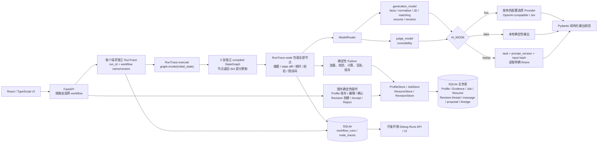
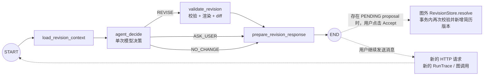

# Career Copilot LangGraph 结构图

按当前 Phase 5 代码整理，核对日期：2026-10-10。本文覆盖全部 **5 张独立 StateGraph、28 个业务/诊断节点**，以及图外的用户确认、持久化与追踪边界。

项目由 FastAPI 根据请求分别构建和执行各张图，没有把这些图编译成一个父图，也没有通过 LangGraph 子图互相调用。下图将它们放在一起展示完整业务链路；每个分组都有自己的 START / END。

## 全部工作流总图

图例：实线表示各张 LangGraph 内真实注册的执行边；虚线表示图外的 API 请求、用户操作或数据衔接，不是 `add_edge`。绿色为 Generation 调用，橙色为 Judge 调用，紫色为保存节点，灰色为图外操作；其他节点执行确定性 Python 逻辑。条件边上的英文与代码里的 action 完全一致。

```mermaid
flowchart TB
    Raw["用户保存原始职业资料<br/>POST /api/profile/raw"]:::external

    subgraph Profile["① Profile 整理 · ProfileState · 6 nodes"]
        direction TB
        PS((START)) --> P1["load_raw_profile<br/>加载原文并检查 expected_version"]
        P1 --> P2["extract_profile_facts<br/>Generation · profile-facts-v1"]:::generation
        P2 --> P3["validate_profile_facts<br/>校验事实、原文引用及数字"]
        P3 --> P4["normalize_profile<br/>Generation · profile-normalize-v1"]:::generation
        P4 --> P5["validate_normalized_profile<br/>校验整理结果与 facts 对应关系"]
        P5 --> P6["persist_profile_draft<br/>版本复查并保存草稿"]:::persist
        P6 --> PE((END))
    end

    Raw -. "用户点击 AI 整理 / profile/normalize" .-> PS
    PE -.-> Confirm["用户审阅 / 编辑 / 确认 Profile<br/>PUT /api/profile<br/>POST /api/profile/confirm<br/>事务内更新 Profile 与 Evidence"]:::external

    subgraph Jobs["② 岗位分析 · JobState · 9 nodes"]
        direction TB
        JS((START)) --> J1["load_confirmed_profile<br/>确认门禁 · profile_version + Evidence"]
        J1 --> J2["extract_job_requirements<br/>Generation · jd-requirements-v2"]:::generation
        J2 --> J3["validate_requirements<br/>严格 JobRequirements schema"]
        J3 --> J4["classify_scoreability<br/>Judge · scoreability-v1"]:::judge
        J4 --> J5["apply_scoreability_guard<br/>Python guard 修正分类"]
        J5 --> J6["match_requirements<br/>Generation · matching-v1"]:::generation
        J6 --> J7["validate_matches<br/>匹配、Evidence 引用与版本校验"]
        J7 --> J8["calculate_coverage<br/>Python 计算覆盖度"]
        J8 --> J9["persist_job_analysis<br/>门禁复查 · 原子保存分析"]:::persist
        J9 --> JE((END))
    end

    Confirm -. "用户提交 JD / POST /api/jobs/analyze" .-> JS
    JE -.-> Generate["用户查看岗位报告<br/>选择 zh / en / ja 并点击生成<br/>POST /api/jobs/{job_id}/resumes"]:::external

    subgraph Resumes["③ 简历生成 · ResumeState · 7 nodes"]
        direction TB
        RS((START)) --> R1["load_resume_context<br/>已确认 Profile + 当前 Job + Evidence"]
        R1 --> R2["generate_resume<br/>Generation · resume-generation-v1"]:::generation
        R2 --> R3["validate_resume_schema<br/>严格 ResumeDraft schema"]
        R3 --> R4["validate_resume_grounding<br/>事实引用、数字及版本校验"]
        R4 --> R5["validate_resume_language<br/>语言约束校验"]
        R5 --> R6["render_resume_markdown<br/>确定性 Markdown 渲染"]
        R6 --> R7["persist_resume<br/>事务复查 · 保存简历与证据快照"]:::persist
        R7 --> RE((END))
    end

    Generate -.-> RS
    RE -.-> Thread["用户创建 / 获取修改会话并提交要求<br/>POST /api/resumes/{resume_id}/revision-threads<br/>POST /api/revision-threads/{thread_id}/messages"]:::external

    subgraph Revision["④ 简历修改 Agent · ResumeRevisionState · 4 nodes"]
        direction TB
        VS((START)) --> V1["load_revision_context<br/>版本门禁 · 当前简历 / Job / Evidence / 最近消息"]
        V1 --> V2["agent_decide<br/>Generation · resume-revision-agent-v1<br/>一次决策并输出 agent_action"]:::generation
        V2 -->|REVISE| V3["validate_revision<br/>grounding + language + Markdown + diff"]
        V2 -->|ASK_USER| V4["prepare_revision_response<br/>保存助手消息<br/>有修改时保存 PENDING proposal"]:::persist
        V2 -->|NO_CHANGE| V4
        V3 --> V4
        V4 --> VE((END))
    end

    Thread -.-> VS
    VE -.-> Decision{"用户审阅修改提案"}:::external
    Decision -. "Accept / revision-proposals/{proposal_id}/accept" .-> Accept["Python 事务再次校验<br/>新增 Resume + lineage<br/>推进 thread 当前版本"]:::external
    Decision -. "Reject / revision-proposals/{proposal_id}/reject" .-> Reject["标记 REJECTED<br/>更新 thread generation"]:::external
    Accept -. "用户提交下一条要求" .-> Thread
    Reject -. "用户提交下一条要求" .-> Thread
    VE -. "ASK_USER：用户回复；NO_CHANGE：用户提出新要求" .-> Thread

    DummyAPI["诊断请求<br/>POST /api/workflows/dummy"]:::external
    subgraph Dummy["⑤ Dummy 诊断 · CareerState · 2 nodes"]
        direction TB
        DS((START)) --> D1["prepare_input<br/>去掉 message 首尾空白"]
        D1 --> D2["mutate_state<br/>counter + 1 · 生成 result"]
        D2 --> DE((END))
    end
    DummyAPI -.-> DS

    classDef generation fill:#dcfce7,stroke:#16a34a,color:#14532d
    classDef judge fill:#ffedd5,stroke:#ea580c,color:#7c2d12
    classDef persist fill:#f3e8ff,stroke:#9333ea,color:#581c87
    classDef external fill:#f1f5f9,stroke:#64748b,color:#0f172a
```

岗位图的两个特殊情况发生在节点函数内部，不改变图的执行边：requirements 为空时 `classify_scoreability` 不调用 Judge；guard 后没有 `SCORED` 要求时 `match_requirements` 不调用 Generation，并返回空匹配。

## 执行、模型与存储结构

这张图展示组件调用和存储关系，箭头不是 LangGraph 的节点边。

Generation 业务任务通过 `generation_model` 调用；岗位可评分性通过 `judge_model` 调用。live 适配器由角色配置决定，典型配置为 Generation → OpenAI-compatible、Judge → Jev。fake/replay 分支不构造网络适配器。

## 图入口与 State

所有图均使用 `StateGraph(...).compile()`，未配置 checkpointer。每次 HTTP 请求创建独立 `RunTrace`，经 `trace.execute(graph, initial)` 调用；各图 State 不互相传递，下游通过 Store 读取已保存的业务数据。

| 图 / workflow name | 构建函数与源码 | API 提供的初始 State | 主要状态产物 |
| --- | --- | --- | --- |
| Profile / `profile_workflow` | [`build_profile_graph`](../backend/career_copilot/workflows/profile.py) | `expected_version` | `raw_input`、`facts`、`normalized`、校验标记、`saved_version` |
| Jobs / `job_analysis_workflow` | [`build_job_graph`](../backend/career_copilot/workflows/jobs.py) | `raw_jd` | `profile_version`、`evidence`、`extraction`、`requirements`、`raw_scoreability`、`matches`、`coverage`、`job_id` |
| Resume / `resume_generation_workflow` | [`build_resume_graph`](../backend/career_copilot/workflows/resumes.py) | `job_id`、`language` | `context`、`evidence`、`profile_version`、`draft`、校验结果、`markdown`、`resume_id` |
| Revision / `resume_revision_agent` | [`build_revision_graph`](../backend/career_copilot/workflows/revisions.py) | `thread_id`、`instruction` | `context`、`base_resume_id`、`generation`、`agent_step_count`、`agent_action`、`proposal`、`diff`、`proposal_id` |
| Dummy / `dummy` | [`build_dummy_graph`](../backend/career_copilot/workflows/dummy.py) | `message`、`counter=0`、`result=""` | 去空白后的 `message`、`counter=1`、`result` |

Revision 的 `instruction` 包含 `content`、`expected_resume_id` 和 `expected_profile_version`。`load_revision_context` 从 SQLite 加载会话和当前简历，构造 Job、Evidence、最近最多 10 条消息与本次要求的模型输入，并将本次 `agent_step_count` 初始化为 0。

## 简历修改的条件路由与人工确认

- `REVISE`：进入 `validate_revision`，通过 grounding 和 language 校验后产生 Markdown 与 diff，再由 `prepare_revision_response` 保存提案和助手消息。
- `ASK_USER`：直接进入响应节点保存追问，返回的 `proposal_id` 为 `None`；用户回复会触发下一次图调用。
- `NO_CHANGE`：直接进入响应节点保存说明，返回的 `proposal_id` 为 `None`。
- 提案接受/拒绝均由图外 API 调用 `RevisionStore.resolve`。Accept 才插入新简历和 lineage，保留父版本；Reject 更新提案状态和会话 generation。

`MAX_AGENT_STEPS = 4` 是 `agent_decide` 的防御性上限。当前图没有回边，每次调用只执行一次 `agent_decide`，不是四轮自主循环；也没有 `interrupt` / `Command(resume=...)`。跨轮对话与提案保存在业务表中。

## 版本、失败与追踪边界

- Profile 整理生成草稿；`ProfileStore.confirm` 在图外的用户确认事务内更新 Evidence。岗位分析读取当前已确认 Profile，记录使用的 `profile_version`。
- 简历生成要求岗位已完成、未过期、Profile 已确认且版本一致。保存时在事务内再次读取门禁并校验；简历修改在 begin、finish、accept 等边界复查基础版本与并发状态。
- 所有节点由 `RunTrace.node` 包装。任一节点抛出异常时，记录失败节点并中止图；`RunTrace.execute` 将 run 标记为 failed，API 返回错误码及 `run_id`。图中没有失败后自动修复边。
- 常规模型调用最多尝试两次，重试由 Provider 调用层统一负责；这是模型请求重试，不是图级循环。
- 节点追踪记录输入/输出摘要、变化字段、校验结果与 AI metadata；全文调试受开发环境和配置开关控制。没有 LangGraph checkpoint 或崩溃自动恢复。
- `/api/debug/replay`、独立 smoke 和 eval 使用自己的执行路径，不是上述五张业务/诊断 StateGraph 的额外节点；debug replay 不写业务表或运行追踪。

## 代码依据

- [API 路由与图的选择](../backend/career_copilot/api.py)
- [节点包装和图执行追踪](../backend/career_copilot/tracing.py)
- [模型角色、fake / replay / live 与重试](../backend/career_copilot/models/router.py)
- [Profile 确认和 Evidence](../backend/career_copilot/profile_store.py)
- [Job 原子保存](../backend/career_copilot/job_store.py)
- [Resume 上下文和保存门禁](../backend/career_copilot/resume_store.py)
- [Revision 会话、提案和接受事务](../backend/career_copilot/revision_store.py)

使用支持 Mermaid 的 Markdown 预览器查看即可渲染结构图；总图适合放大查看，简历修改局部图便于单独阅读。
