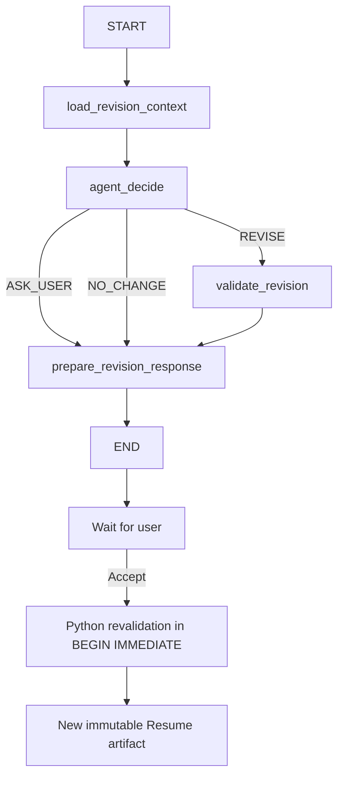

# Phase 5 — Resume Revision Agent

2026-10-10（Asia/Shanghai）。仅实现 Resume conversational revision；所有执行与验证为 offline/fake/replay，Agent live requests = 0。

## Agent Boundary

Profile extraction、JD extraction、scoreability、matching 和 initial Resume 保留固定 workflow。只有 revision instruction 的响应方式需要运行时决策，因此新增一个 bounded local agent。

Agent 从 REVISE / ASK_USER / NO_CHANGE 中选择，输出 `ResumeRevisionProposal`。Python 预加载当前 accepted Resume、当前 Job 的 raw JD / requirements / matches / coverage、同一 confirmed Profile version 的全部 active Evidence，以及当前 thread 最近 10 条消息。第一版不需要 LOAD_EVIDENCE。新 instruction 始终基于 accepted Resume；未确认 proposal 不作为 base。

Agent 可以决定如何表达、是否提出修改、是否追问。不能决定跳过 validation、保存、修改 Profile/Evidence/Job、重分析、扩权；没有 filesystem/shell/Git/web/MCP/Plugin/tools/sub-agent/multi-agent/RAG/long-term memory。用户要求与聊天记录不是候选人事实来源；新经历必须先在 Profile 更新并确认。Job/GAP/matching reasons 只提供表达重点，不建立事实。

## Graph

独立 `workflows/revisions.py`，不修改 `workflows/resumes.py` 或 `resume-generation-v1`。

一次 invocation 只有一次模型 decision，同时返回完整 structured revision。无 self-reflection/repair loop；RoleModel 继续原 schema retry policy（最多一次 retry）。`MAX_AGENT_STEPS=4`，每次 decision 前检查，超限报 `REVISION_STEP_LIMIT_EXCEEDED`。ASK_USER 等待下一条用户消息，NO_CHANGE 仅响应，均不创建 proposal artifact。REVISE 校验后生成 deterministic diff 并等待明确确认。

## Models and contract

`models/revisions.py`：AgentAction、ProposalStatus、RevisionChange、ResumeRevisionProposal、RevisionExpected、RevisionInstruction、RevisionThread、RevisionMessage、RevisionArtifact。严格禁止 extra fields；REVISE 必须有 updated_resume，其余动作必须为 null 且无 change_summary。

`ResumeDraft` 直接复用，不维护第二份简历 schema。`resume-revision-agent-v1` 绑定 Generation / high / 7000 output tokens，沿用 Generation timeout；其他 task policy、timeout、initial prompt 不变。Pydantic → compact contract → Prompt → configured json_object/json_schema → Pydantic。为 nullable ResumeDraft 增加递归 `anyOf` contract 处理，保留内嵌 required/enum/constraints；未知 keyword、递归或无效 ref 仍失败。没有手写输出 shape。

## Grounding

直接复用 `ResumeDraft.model_validate`、`validate_grounding`、`validate_language`、`numbers()` 和 `render_markdown`。proposal 与 accept 都执行引用、active/current version、numeric、语言、空内容、section/ref duplicate 校验。不能切换语言。Markdown 全部由 Python renderer 生成。

保留现有准确性边界：引用和 numeric checks 不能证明开放文本的语义蕴涵，也不能检测所有指标范围偷换或不含数字的虚构技能。Prompt 明确禁止这些行为，用户仍需审核。language check 验证 language 字段一致，未增加自然语言识别器。`unsupported_fact_count` 是 invalid/missing citation item count，不是语义真实性总分。

## Persistence and concurrency

SQLite v5 幂等新增 threads/messages/proposals/lineage 四表，保留 v4 resumes 表结构，避免修改 initial insertion 路径。lineage 保存 parent_resume_id/revision_thread_id/revision_number；Resume GET 同时返回这些字段。FK 保留 parent、thread 与 artifact 关系。与现有 Resume 一样，job_id 不使用 Job 删除级联，删除 Job 后历史仍可读且 outdated。未知更高 schema version 拒绝启动。

每个初始 Resume 独立 thread；其 accepted 子版本延续同一线性 conversation，其他初始 Resume 不共享历史。Thread 固定 job_id/profile_version，不自动迁移。历史 UI 保留全部消息，模型仅取最近 10 条，不创建 summary memory。

Proposal lifecycle：PENDING → ACCEPTED / REJECTED / SUPERSEDED。partial unique index 强制每 thread 最多一个 PENDING。提交新消息时，旧 pending 原子变 SUPERSEDED；基于最新 accepted base 重新处理。所有 mutation API 携带 expected_resume_id + expected_profile_version。generation counter 使并发模型返回只能发布最新请求结果。parent 唯一约束防止重复 accepted child。

Accept 使用 BEGIN IMMEDIATE，重新读取 proposal/status/thread/current base/confirmed Profile/version/Job/active Evidence，重新校验并渲染。一次事务插入完整新 Resume + Evidence snapshot + lineage、更新 current pointer/generation、标记 ACCEPTED。重复确认、stale base/profile、Job 删除/过期、Evidence 改变均返回 409，不保存半成品。validation 在 proposal 阶段失败为 REVISION_VALIDATION_FAILED。Reject 只更新 proposal/thread，不改变 Resume。参与 revision history 的 Resume 禁止删除（409），保留 parent chain；没有 thread 的旧 initial Resume 仍可按原功能删除。

API：

- POST /api/resumes/{resume_id}/revision-threads
- GET /api/resumes/{resume_id}/revision-thread
- POST /api/revision-threads/{thread_id}/messages
- POST /api/revision-proposals/{proposal_id}/accept
- POST /api/revision-proposals/{proposal_id}/reject

不提供通用 chat API。错误使用安全 ErrorCode，不暴露异常正文。

## Frontend

保留 Resume Detail 正文/Markdown/Evidence/Print，增加独立 RevisionPanel：conversation、textarea/Send、loading/error、pending summary、Python diff Before/After、Accept revision/Reject、Base/Parent/Revision # 链接。diff 以 headline/summary/sections 比较，包含内容、排序和引用变化；模型 summary 仅供辅助阅读。历史 base 与 outdated Resume 只读；只有明确点击 Accept 才保存和导航到新 artifact。

## Observability

每 invocation 保留 run/node/duration/status/state diff 和既有完整 AI metadata（model role/provider/model/prompt/reasoning source/timeout/tokens/latency/retry/structured mode/contract hash）。新增 agent_step/agent_action，action 仅有限 enum。默认 trace 只记录消息 length/shape；development + AI_DEBUG_PAYLOADS=1 才保存全文 debug payload。conversation DB 保存产品消息；不保存 hidden reasoning。

## Evaluation and regression

8 个 reviewed synthetic replay cases：局部措辞、重排、岗位强调、无 Evidence 的 CUDA、故意不支持的 99% 数字、ASK_USER、NO_CHANGE、多 Evidence。8/8 预期行为与校验结果通过；schema/action 8/8，refs 全合法，language 保持，故意注入的 numeric 错误正确拒绝。结果见 [revision.json](../evals/results/phase_5/revision.json)。这是 fixture regression，不代表 live 模型质量；无“总准确率”。fake 仅做 punctuation/reorder 等确定性操作演示，不模拟真实 reasoning。

`scripts/eval_resume_revision.py` 强制 replay，没有 live flag。API 测试另验证 DB 中未确认/拒绝时 base 完全不变，以及 accept 新 ID/parent chain、失效门禁、隔离、并发、超限、extra fields、事务插入失败回滚、migration/restart。MockTransport 精确验证 revision 的 json_object/json_schema、high/task、7000 output budget 和 timeout wire；不发网络请求。

全部离线命令和临时空数据库 fake HTTP `scripts/check_http.py --resume` 通过（包括生成 → thread → proposal → reject → proposal → accept → 新 artifact，及 Profile/Job/trace/proxy）。临时服务、配置和 DB 已清理。后端 449 tests、前端 29 tests；Ruff/check/build/audit 通过（0 vulnerabilities），Profile 10-case、Jobs 12/8/5-case、Resume 6-case、Revision 8-case eval 全通过。Agent live requests = 0。完成提交后 STOP，不执行 live manual acceptance，不开始后续 Phase。
